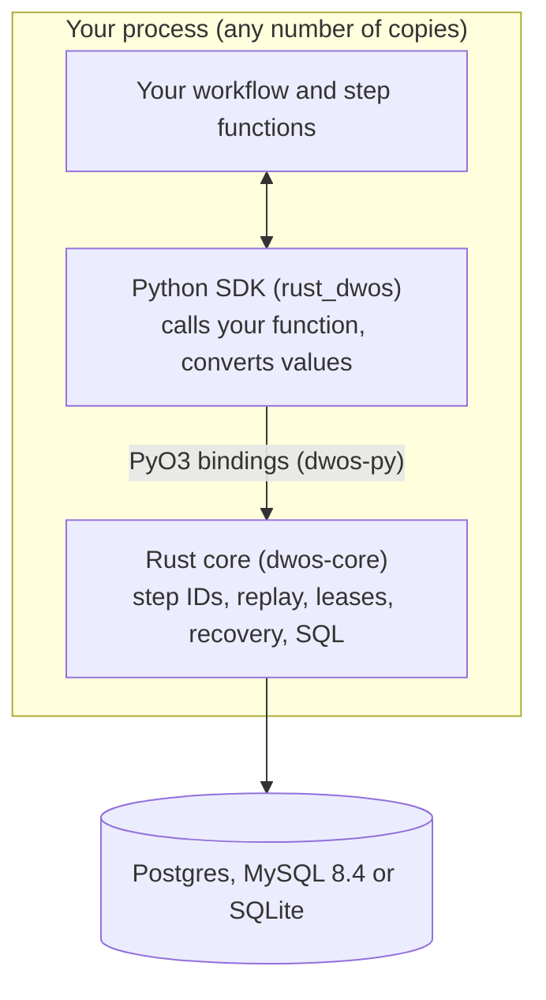
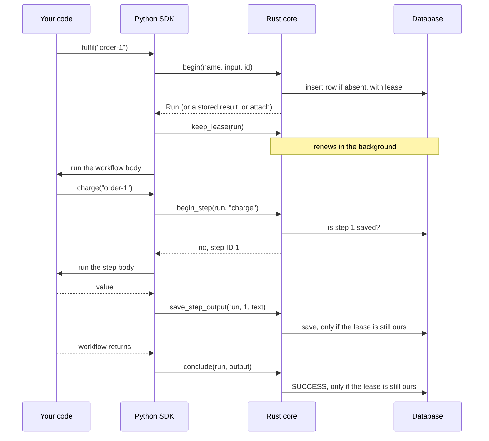
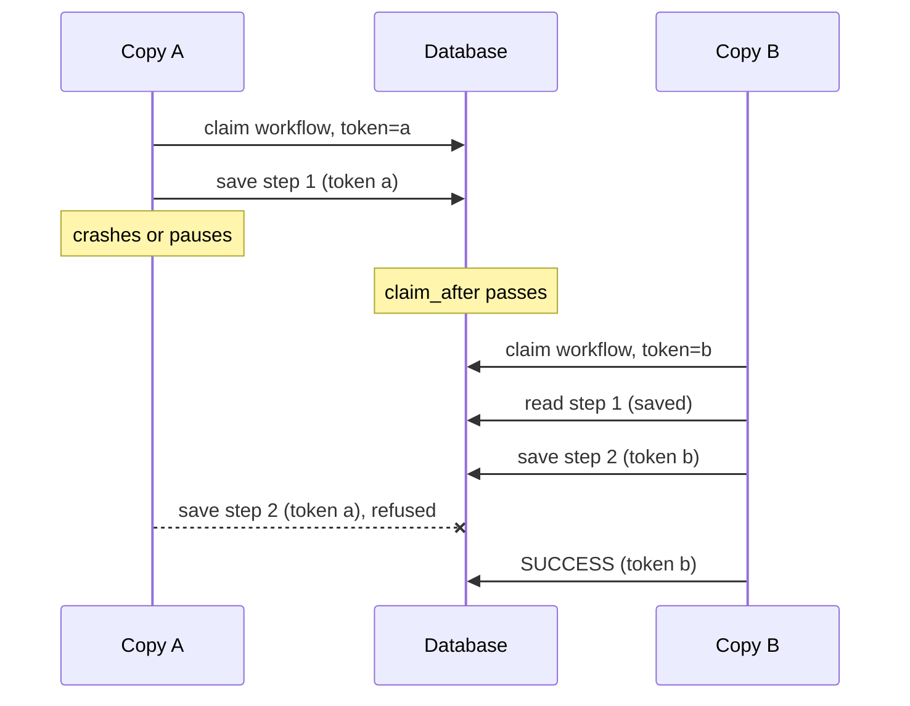

# Architecture

rust-dwos is a library inside your process, with a database behind it. There is no coordinator, broker or worker service. A running copy of your program is the coordinator.

Python calls Rust. Rust never calls Python. Python asks what to run, runs it, and hands back the result.

## Who does what

The rule: Python holds only what needs the Python interpreter. If an SDK in another language would have to rewrite it, it belongs in Rust.

| Python keeps | Rust keeps |
|---|---|
| `DBOS` class, decorators, handles | All SQL |
| Calling your function and catching its exceptions | Step IDs and replay |
| Current workflow and step (`contextvars`) | Leases and recovery |
| Converting values and errors to stored text | Retry limits and delays |
| `asyncio` tasks, threads and the actual sleep call | Stored statuses and formats |
| Mapping workflow names to functions | What happens when a workflow ends |

`tests/test_boundary.py` fails if Python imports a database driver or contains SQL. A few decisions are still in `dbos.py`. They are listed under Known problems in `PROGRESS.md`.

## Life of a workflow

`begin` has three outcomes:

| Row for this ID | Outcome |
|---|---|
| None | A new row is written, and this process owns it |
| Finished | The stored result or error comes back. Nothing runs |
| Still running | The caller attaches and waits for the result |

## How replay works

A workflow's steps are numbered from 1, in call order. Each call to a step asks Rust for the next number.

- **The number is saved:** the stored value or error comes back. The step body does not run.
- **The number is not saved:** the body runs, and its result is saved.
- **The number is saved under another name:** the code has changed, and an error is raised.

So recovery is simple. It calls the workflow function again from the top, with the saved input. Saved steps return at once, and the function arrives at the first unsaved step with the same local values it had before.

This is why a workflow body must be deterministic, and why outside work belongs in steps.

Other durable calls use the same numbers. `DBOS.sleep`, `send`, `recv`, `set_event`, `get_event` and starting a child workflow all take step IDs. Work inside a step belongs to that step's result and takes no ID of its own.

## How crash recovery works

Crash detection uses leases. Each running workflow row has two columns for this:

| Column | Meaning |
|---|---|
| `lease_token` | A random value that names the current owner |
| `claim_after` | Database time after which anyone else may claim the row |

**Keeping a lease.** While a workflow runs, a background task in Rust pushes `claim_after` forward. With the default 30 second lease it renews about every 10 seconds. If it cannot renew for 25 seconds (five sixths of the lease), it tells Python the lease is lost, before anyone else can claim the row.

**Finding dead owners.** Every copy runs a recovery loop, about once a second with random jitter. It claims `PENDING` rows whose `claim_after` has passed, whose function name this process has registered, and whose stored format it can read. A claim writes a new `lease_token` and adds one to `recovery_attempts`.

**Fencing old owners.** Every write checks the `lease_token`. A paused process that wakes up after losing its row cannot save a step or a result. Its write fails, and Python stops the body.

**What this does not cover.** A check cannot stop a step that has already started. If a process pauses after the check and before calling your function, or crashes after a side effect and before the save, the step runs again. That is why steps are at least once and need idempotency keys.

**Limits.**

| Limit | Default | When reached |
|---|---|---|
| `max_recovery_attempts` per workflow | 100 | The row ends as `MAX_RECOVERY_ATTEMPTS_EXCEEDED` |
| `max_run_seconds` per run | 1 hour | The lease is released and the body is stopped, so the workflow can run again by replay. A sync body cannot be stopped and runs on, but it cannot save |
| `max_concurrent_recoveries` per process | 50 | Recovery claims only `50 - runs active in this process`. At 50 or more active runs, this process claims nothing until some finish |

## Shutdown is not failure

`DBOS.destroy()` tells the engine it is closing, then cancels running work. An error raised after that is not stored as a final result. The lease is released, and the workflow runs again on the next start.

## Time

Lease expiry, sleep wake times, deadlines and cron ticks use the database clock, never the machine's. Machines can disagree about the time, but they share one database.

## How waiting works

MySQL and SQLite have no `LISTEN/NOTIFY`, so the core uses one method everywhere:

- A write on the same engine wakes local waiters at once. This takes about 10 to 17 ms for a message.
- A write from another process is seen by re-reading. The read starts at 10 ms and backs off to 250 ms.

A sleeping or waiting workflow costs about 4 database reads per second when there is no local wake. Numbers are single samples from a busy machine. No benchmark exists yet.

## Queues

Queues add two tables and keep the same workflow row. A queue entry is a row in `workflow_queue_entries`, and the workflow's stored status stays `PENDING`. It reads as `ENQUEUED` until it is admitted.

One transaction does the admission: it revokes expired owners, counts the remaining owners, and admits the next rows in FIFO order up to the limit. Because the count is in the database, the limit holds across all copies. Ordinary recovery skips queue members, so nothing bypasses admission.

## Tables

| Table | Holds |
|---|---|
| `workflow_status` | One row per workflow: name, status, input, output, error, owner, lease |
| `operation_outputs` | One row per saved step, keyed by workflow and step number |
| `notifications` | Messages from `send`, waiting for `recv` |
| `workflow_events`, `workflow_event_history` | Values from `set_event`, and older revisions so that replay reads the right one |
| `workflow_timeouts` | Workflow deadlines |
| `workflow_queues`, `workflow_queue_entries` | Queue limits and queue membership |
| `workflow_schedules` | Cron schedules and their last fire time |
| `dwos_schema_migrations` | Which numbered migrations have run |

Table names follow DBOS, but the shape does not. rust-dwos cannot read rows written by another DBOS SDK.

## Running several copies

Every copy of your program connects to the same database. Rows hold all the shared state: checkpoints, queue membership, schedules and ownership. Copies never talk to each other. To spread work across them, use a [queue](guide/queues.md). Any copy that registered the queue can take the next entry.

> **Coming soon:** an external client (`DBOSClient`), so that a program not running workflows can enqueue and watch them.

## How it scales

The database sets the limit, because each step and each workflow writes to it. DBOS publishes a rule of thumb for Postgres, about 1,000 workflows or steps per vCPU per second. That figure is not checked here and may not apply to this engine.

Nothing has been measured for rust-dwos. Known costs from reading the code:

- Each sleeper or waiter with no local wake reads about 4 times per second.
- Each queue slot re-scans pending rows while holding the queue row lock, which also blocks enqueues.
- Recovery takes at most 50 workflows per interval by default.

Keep step outputs small, because each one is stored as a row value.

> **Coming soon:** a full benchmark.

## Upgrading workflow code

A change is breaking if it alters which steps a workflow runs, or their order. An unfinished run replays on the new code, sees a saved step that does not match, and raises an error. Let old runs finish or cancel them before you deploy such a change.

> **Coming soon:** patching and app versions, which DBOS uses to keep old runs working.

## One store for three databases

The SQL is written once, through the `sqlx` `Any` driver. Only these differ per database: the schema files, "now in milliseconds", the insert-if-absent clause, the row lock clause, the start of a transaction, connection settings, and which errors can be retried. Each feature's code sits in matching files:

| Part | File |
|---|---|
| SQL | `crates/dwos-core/src/store/<feature>.rs` |
| Decisions | `crates/dwos-core/src/engine/<feature>.rs` |
| Tables | `crates/dwos-core/schema/<database>/NNN_<change>.sql` |
| Bindings | `crates/dwos-py/src/<feature>.rs` |
| Python API | `python/rust_dwos/<feature>.py` |

## How it differs from DBOS

| Topic | DBOS | rust-dwos |
|---|---|---|
| Core language | Python | Rust, with a Python SDK |
| Databases | Postgres, SQLite | Postgres, MySQL 8.4, SQLite |
| Crash detection | Executor IDs and ownership tokens | Leases that expire |
| Hosted control plane | DBOS Conductor | None. There is a small read-only local page |
| Stored rows | The `dbos` schema | Similar tables, not compatible |
| Custom exceptions after replay | Restored as their own type | Restored when the class is loaded and can be rebuilt. Otherwise `DBOSRecordedError` |

The full comparison is the feature checklist in `README.md`.
