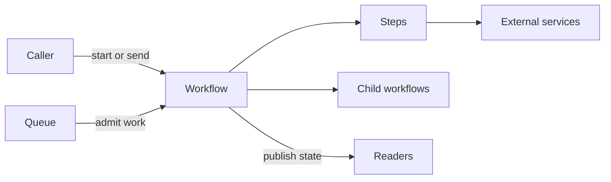

# Temporal patterns

> The [Temporal design pattern catalog](https://docs.temporal.io/design-patterns), written for yado. Same groups, same page shape, and a status on every pattern.

Temporal organizes these patterns by the problem they solve. Each page here follows that shape: what the pattern is, the problem it addresses, the solution, a complete example, when to use it, and the pitfalls.

Of the 35 patterns, **28 work today**. **Five have no single call yet**: [request and response](request-response.md), [continue-as-new](continue-as-new.md), [a time budget across retries](wall-time-retries.md), [an error that sets the next wait](delayed-retry.md), and the [batch iterator](batch-iterator.md). Two more work except for one feature: [heartbeat details](long-running-step.md) on a long-running step, and a [deadline while a pinned host is dead](worker-queues.md). Those pages show the closest thing you can write. None of this needs a separate server.

## How the patterns fit together

A workflow coordinates durable steps. It can start child workflows, exchange messages with callers, and use queues to control when work starts. Each pattern page explains the limits of its yado implementation.

## Names

| Temporal | Here |
|---|---|
| Workflow | Workflow |
| Activity | [Step](../guide/steps.md) |
| Task queue | [Queue](../guide/queues.md) |
| Signal | [`yado.send`](../guide/communication.md) and `yado.recv` |
| Query | [`yado.set_event`](../guide/communication.md) and `yado.get_event` |
| Update | No single call. See [Request and response](request-response.md) |

## Task orchestration

These patterns break work up, run it together, or race it.

- [Child workflows](child-workflows.md). A workflow starts another workflow. The child has its own ID, steps, and lifecycle. Supported.
- [Parallel execution](parallel-execution.md). Run steps or children together and wait for all of them. Supported.
- [Pick first](pick-first.md). Race several runs, take the first result, and cancel the rest. Supported.

## Messaging

These patterns move a request or a stream of events into a workflow.

- [Signal with start](signal-with-start.md). Start a workflow if it is not running, then send it a message. Supported.
- [Request and response](request-response.md). Validate a request, change the workflow, and return the answer in one call. Not supported yet.
- [Event accumulator](event-accumulator.md). Collect messages from many senders, then move on after a quiet period. Supported.

## Entity and lifecycle

These patterns keep one long-lived workflow per business object.

- [Entity workflow](entity-workflow.md). One workflow per account, order, or device. Messages drive each change. Supported.
- [Continue-as-new](continue-as-new.md). End the current run and start a fresh step list under the same ID. Not supported yet.
- [Updatable timer](updatable-timer.md). A wait whose deadline a message can move. Supported.

## External interaction

These patterns talk to people and to systems outside the workflow.

- [Polling an external service](polling.md). Ask an outside system for status, on a short loop or a long one. Supported.
- [Long-running steps](long-running-step.md). A step reports that it is still alive. Heartbeat details are not supported yet.
- [Delayed start](delayed-start.md). Create the workflow now and run it later. Supported.
- [Delayed callback](delayed-callback.md). Sleep, call out, and wait for the other side to answer. Supported.
- [Approval](approval.md). Stop until a person sends a decision. Supported.

## Distributed transactions

These patterns commit work that spans more than one service.

- [Saga](saga.md). Each step has an undo. On failure, run the undos in reverse. Supported.
- [Early return](early-return.md). Give the caller the fast part, and keep working after that. Supported.

## Retries

These patterns bound, classify, or pause retries.

- [Fixed number of retries](fixed-retries.md). Cap how many times a step runs. Supported.
- [A time budget across retries](wall-time-retries.md). Cap the total time of every attempt together. Not supported yet.
- [Errors that must not be retried](non-retryable.md). Fail immediately on errors that will never succeed. Supported.
- [An error that sets the next wait](delayed-retry.md). Use a wait time that the error itself reports. Not supported yet.
- [Fast retries, then slow ones](fast-slow-retries.md). Retry quickly, then back off to a long interval. Supported.
- [Alert when retries pile up](retry-alerting.md). Emit a metric once attempts pass a threshold. Supported.
- [Resume after a correction](resumable.md). Park the workflow until a person sends a fixed input. Supported.

## Batch processing

These patterns walk a large set of records.

- [Fan-out](fan-out.md). One child workflow per chunk, all at once. Supported.
- [Batch iterator](batch-iterator.md). Page through an unbounded set without keeping every page in one run. Not supported yet.
- [Sliding window](sliding-window.md). Keep a fixed number of children running. Supported.
- [Map-reduce](mapreduce.md). Split the set into a tree, process the leaves, and add the results back up. Supported.

## Throughput

These patterns protect a downstream service and share capacity.

- [Rate limiting](rate-limiting.md). Cap how often work starts. Supported.
- [Priority](priority.md). Run time-sensitive work ahead of the rest. Supported.
- [Fairness](fairness.md). Stop one tenant from taking every slot. Supported.

## Latency

These patterns shorten the path from the caller to the first result.

- [Local steps](local-steps.md). Run a step in the workflow's process, with no extra hop. Supported. This is how every step already runs.
- [Early return with local steps](early-return-local.md). The first response comes from in-process work. Supported.
- [Eager start](eager-start.md). The caller runs the workflow body as soon as the row is written. Supported.

## Workers

These patterns decide where a step runs and how it gets its clients.

- [A queue per host](worker-queues.md). Pin work to one process. A deadline for a dead host is not supported yet.
- [Pass clients into steps](dependency-injection.md). Build clients at startup and close over them. Supported.
