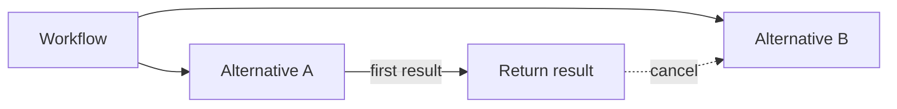

# Pick first

> Start several alternatives, take the first result, and cancel the rest.

:::note[Supported]

`yado.wait_first` waits on workflow handles. `yado.asyncio_wait(..., return_when=asyncio.FIRST_COMPLETED)` waits on steps.

:::

## Overview

Pick first races equivalent ways of getting one result. The winner's result is the workflow's answer. The others are cancelled so they do not keep spending money or time.

The starts are saved. After a crash, the workflow attaches to the same runs and waits again.

## Problem

Three providers can quote a shipment. Waiting for the slowest one dominates the latency. Keeping the slower calls running after you already have a price wastes the calls and can book a second shipment.

## Solution

The workflow returns the first completed result and requests cancellation of the other runs.



Start every racer, wait for the first handle to finish, and cancel the others.

```python
import yado


@yado.workflow()
def quote(order_id: str) -> str:
    handles = [yado.start_workflow(racer, order_id, name) for name in ("a", "b", "c")]
    winner = yado.wait_first(handles)
    for handle in handles:
        if handle is not winner:
            yado.cancel_workflow(handle.workflow_id)
    return winner.get_result()
```

`wait_first` returns the handle that finished first. `polling_interval_sec` sets the pause between database reads. The default is 1 second.

For steps in an async workflow, race the awaitables:

```python
import asyncio

done, pending = await yado.asyncio_wait(calls, return_when=asyncio.FIRST_COMPLETED)
```

Cancel the `pending` set yourself. `asyncio_wait` does not cancel them.

## When to use

Use pick first when:

- Any one success is enough.
- The losers are safe to cancel.
- The racers are children or steps, so a replay does not start a new race.

Use [parallel execution](parallel-execution.md) when you need every result.

## Trade-offs

You pay for overlapping work until the first one finishes and the cancels land. A racer that has already called an outside service may still complete that call.

## Pitfalls

- A cancelled sync body keeps running until its next durable call. Python cannot stop a thread. An async body can be cancelled at an await.
- Cancel is a request. Check the loser before you act on the winner if both could have booked the same resource.
- `wait_first` outside the ordering above can observe a finish that a replay must also observe. Start the handles first, then wait.

## Related

- [Parallel execution](parallel-execution.md)
- [Child workflows](child-workflows.md)
- [Managing workflows](../guide/management.md#cancel)
