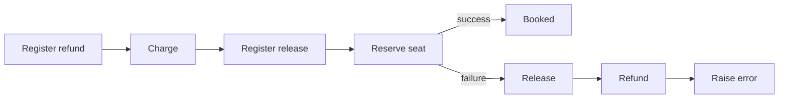

# Saga

> Give each forward step a compensation. If a later step fails, run the compensations that already ran, in reverse order.

:::note[Supported]

Keep the compensations in a list and call them from the workflow's `except` branch. Each compensation is a step, so a crash mid-undo resumes the undo.

:::

## Overview

A saga is a sequence of steps that do not share a transaction. Each step that succeeds records how to undo itself. When a later step fails, the workflow undoes the earlier ones from newest to oldest, then re-raises.

The workflow is the coordinator. The services stay responsible for making each call idempotent.

## Problem

Booking a trip charges a card and then reserves a seat. The reserve fails. The charge has to be refunded. Doing the refund in a `finally` of the HTTP handler is lost if the process dies after the failure and before the refund. Doing nothing leaves the customer charged with no seat.

## Solution

If the seat reservation fails, the example runs release and refund in reverse registration order.



Append the compensation before the forward step, so a crash during the forward step still knows what to undo if that step did take effect. Each function is a step.

```python
import yado


@yado.workflow()
def book(trip_id: str) -> str:
    undo = []
    try:
        undo.append(refund)
        charge(trip_id)
        undo.append(release)
        reserve(trip_id)
        return "booked"
    except Exception:
        for compensate in reversed(undo):
            compensate(trip_id)
        raise
```

`charge` and `reserve` use an idempotency key of `DBOS.workflow_id` and `DBOS.step_id`, so a retry of the forward step does not charge twice. The compensations need the same treatment.

## When to use

Use a saga when:

- Two or more services each have their own transaction.
- You can name an undo for every step that must not be left in place.
- The undo is safe to run more than once.

Use a single database transaction when every write is in the same database and you do not need the workflow's retry and recovery.

## Trade-offs

The happy path is a straight line. The failure path is more code, and it has to be just as durable as the forward path. A compensation that fails fails the workflow. On the next recovery the finished compensations return their saved results and the failed one runs again.

## Pitfalls

- A cancel or a workflow timeout stops the body. The `except` branch does not run, so those compensations do not run either. If cancel must undo, put the undo where cancellation is handled, or check for cancellation yourself.
- Append the compensation before the call it undoes if the call can succeed and then fail to save. Otherwise a crash in that window has nothing to undo.
- Compensations run as part of the same workflow. A compensation that starts its own child is fine, and it is another row to keep track of.

## Related

- [Early return](early-return.md)
- [Fixed number of retries](fixed-retries.md)
- [Steps](../guide/steps.md#at-least-once)
