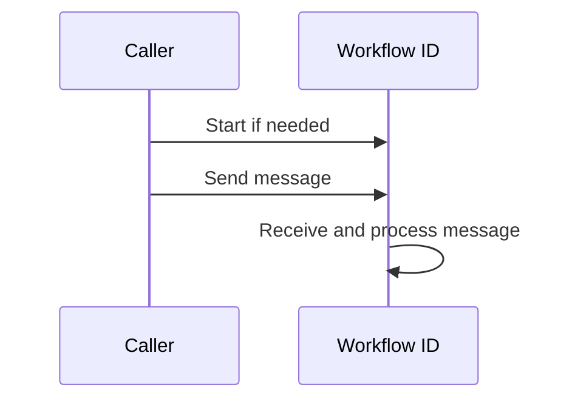

# Signal with start

> Start a workflow when you send to it, if that workflow ID is not already running. If it is running, deliver the message to that run.

:::note[Supported]

Set the workflow ID, start the workflow, then `yado.send`. A start against a running ID attaches to that run. The two calls are not one transaction.

:::

## Overview

Signal with start is how an outside event finds its workflow. The webhook, the queue consumer, or the other service does not have to know whether the workflow has been created yet.

The message waits in the database until the workflow reaches `yado.recv` for that topic. A restart does not drop it.

## Problem

An order workflow should exist once, and every later "item added" event should reach that same run. Creating the workflow in one place and sending from another loses events that arrive first, or starts a second run.

## Solution

The caller starts or finds the workflow by ID, then sends a message in a separate call.



Pick the workflow ID from the business key. Start under that ID, then send.

```python
import yado
from yado import SetWorkflowID


def item_added(order_id: str, sku: str) -> None:
    with SetWorkflowID(order_id):
        yado.start_workflow(fulfil, order_id)
    yado.send(order_id, {"sku": sku}, topic="item", idempotency_key=f"{order_id}:{sku}")
```

Inside the workflow, read the message:

```python
@yado.workflow()
def fulfil(order_id: str) -> None:
    item = yado.recv("item", timeout_seconds=3600)
    if item is not None:
        pack(item["sku"])
```

`yado.send` from outside a workflow is not replayed. Pass `idempotency_key` when the caller can retry, so a repeated webhook does not enqueue a second message.

A start against an ID that is already running attaches to that run and does not start another. See [Workflow IDs](../guide/workflows.md#workflow-ids).

## When to use

Use signal with start when:

- One business key should map to one workflow.
- The sender cannot tell whether the workflow exists.
- The workflow reads the payload later with `recv`.

Use a plain `start_workflow` when you have no message to deliver.

## Trade-offs

The start and the send are two calls. A crash between them can leave a workflow with no message, or a message that arrives before `recv`. The message waits. A workflow that never receives that topic leaves it unread.

## Pitfalls

- A message sent to a finished workflow is not read.
- A finished ID does not start again. `SetWorkflowID` against a finished run returns the stored result.
- `recv` returns `None` when `timeout_seconds` elapses. Loop if the workflow should stay open. See [Entity workflow](entity-workflow.md).

## Related

- [Event accumulator](event-accumulator.md)
- [Entity workflow](entity-workflow.md)
- [Messages and events](../guide/communication.md)
