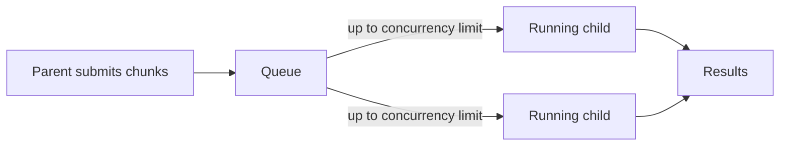

# Sliding window

> Keep a fixed number of workflows in flight. When one finishes, the next starts.

:::note[Supported]

A queue with `global_concurrency` is the window. It holds the cap across every copy of the program. The next queued workflow starts when a slot frees.

:::

## Overview

A sliding window is a concurrency limit with a backlog. Work is enqueued up front, or as you discover it. At most N runs are admitted. Completion frees a slot, and the queue admits the next row in order.

Temporal often builds the window inside one parent workflow and uses continue-as-new so the parent can outlive the set. The queue here is the same cap, enforced in the database, for every process that registered the queue.

## Problem

Fan-out of 10,000 children starts 10,000 workflows together. The downstream API then returns 429s, and the workers spend their time retrying. A process-local semaphore does not survive a crash and does not coordinate with the other copies of the program.

## Solution

The queue limits how many child workflows run at once. As a child finishes, another can start.



Enqueue one workflow per record on a queue whose concurrency is the window size.

```python
import yado
from yado import SetWorkflowID


queue = yado.register_queue("records", global_concurrency=10)


def submit(record_ids: list[str]) -> None:
    for record_id in record_ids:
        with SetWorkflowID(record_id):
            queue.enqueue(handle_record, record_id)
```

`handle_record` is a workflow. Ten of them run at once. When one finishes, the queue admits the next `ENQUEUED` row. If a process dies, its slot frees when its lease expires and another process can admit the workflow again.

A single parent that wants to wait for the whole set can still start children itself and bound them with the same queue: enqueue from the parent instead of `start_workflow`. The parent's `get_result` calls wait, and the queue decides how many run.

## When to use

Use a sliding window when:

- The set is large.
- A downstream system, or your own machines, cannot take every record at once.
- More than one copy of the program will pull work.

Use [fan-out](fan-out.md) when the set is small and you want every child started immediately.

## Trade-offs

The cap is global, which is what you want for a shared API key. It is not "ten per parent". Two parents enqueueing to the same queue share the ten slots. Use a queue per job if each job should have its own window.

Admission is FIFO within a priority. It is not "the fastest record pulls the next one" inside a single parent. The effect is the same: a free slot starts the next eligible row.

## Pitfalls

- Only a process that has registered the queue runs its work. A queue with no registered process waits.
- `global_concurrency` limits running workflows, not steps inside them. A workflow that then fans out unconstrained steps can still overload the downstream service. Put the call in the queued workflow.
- Enqueue is not idempotent unless you set a workflow ID, as above, or enqueue from inside a workflow.

## Related

- [Fan-out](fan-out.md)
- [Rate limiting](rate-limiting.md)
- [Queues](../guide/queues.md)
